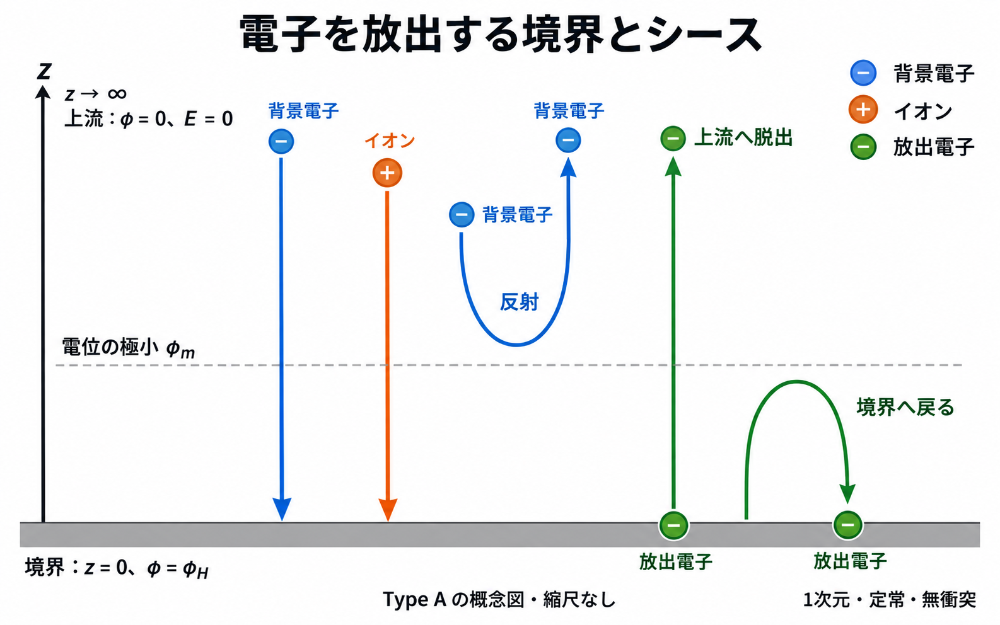
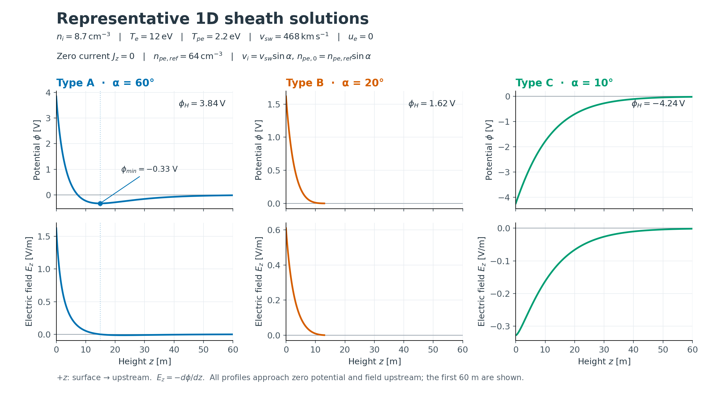
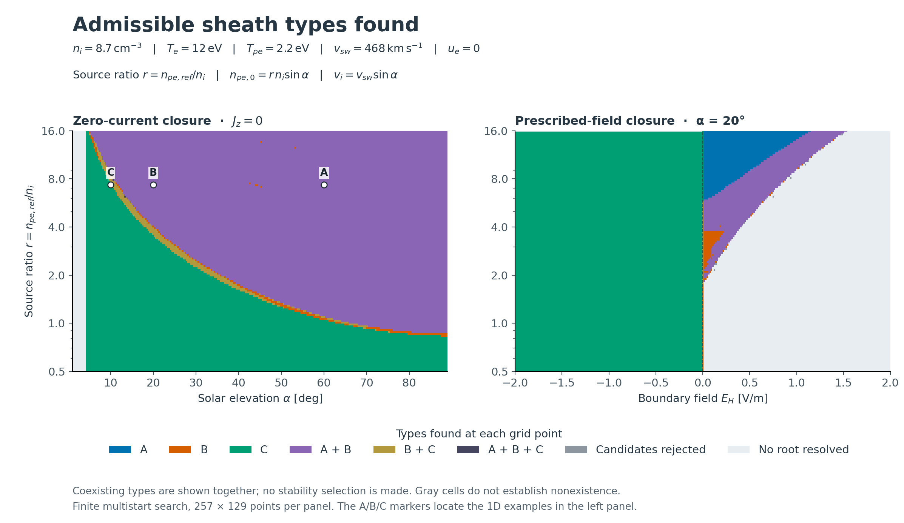

# sheath-model

電子を放出する平面上の一次元・定常シースを解く Fortran ライブラリと Python パッケージです。
境界の電位、電位・電場のプロファイル、粒子流束を求めます。上流の条件に応じて次のモデルを使えます。

- **準中性域に接続する Zhao モデル**は、上流の電子の規格化を解き、Type A/B/C のシースを求めます。Fortran では零電流、境界電場の指定、電位を与えた静的評価を使えます。
- **遠方の電子分布を固定するモデル**は、谷の位置の判定、上端 0 V の有限箱、電子の置換で遠方につながる準中性の外側領域を扱います。Python で使えます。
- **シミュレータ結合**では、計算領域から出る電子のスペクトルを外部シースへ渡し、接合面の電位・電場と流束を求めます。Fortran では零電流での更新に加え、内外の電場差と電流残差を同時に評価する候補選択を使えます。



Type A を例にした粒子の動きの概念図です。矢印は粒子の進む向きを表し、横方向の配置・曲がりは集団を見分けるためのものです。
各集団と Type A/B/C の違いは [物理モデル](docs/model.md)、計算領域へのつなぎ方は [シミュレータとの結合](docs/coupling.md) を参照してください。

## 計算例

### Type A/B/C のプロファイル

太陽高度を変えたときの電位と電場です。`J=0`・電子ドリフト 0、表面から最初の 60 m を表示しています。

[](docs/figures/sheath_profiles.pdf)

[計算条件・CSV データ](docs/examples.md#profiles)（画像をクリックすると PDF）

### 解の Type マップ

左は `J=0`、右は `E_H` 指定で見つかった解の Type です。いずれも電子ドリフト 0 です。

[](docs/figures/sheath_type_maps.pdf)

複数 Type の表示は安定性による選択を意味しません。灰色領域も含め、解の不存在や全根の発見は保証しません。
[計算条件・凡例・CSV データ](docs/examples.md#maps)（画像をクリックすると PDF）

## 機能

| 機能 | Fortran | Python |
| --- | :---: | :---: |
| J=0（固定入口・太陽高度入力） | ✓ | ✓ |
| E_H 指定、静的評価 | ✓ | |
| Zhao モデルの bin スペクトル放出源 | ✓ | |
| プロファイル・局所密度 | ✓ | ✓ |
| 局所の速度分布・流束 | | ✓ |
| 解マップ・continuation | ✓ | ✓（J=0） |
| 固定した遠方の入射での分岐診断・有限箱・外側領域 | | ✓ |
| 接合面の条件、零電流更新と checkpoint、電場・電流を合わせる候補選択 | ✓ | |

Python は Fortran のバインディングではなく、NumPy/SciPy による独立した実装です。

## 使い始める

fpm プロジェクトの `fpm.toml` に依存を追加し、`use sheath_model` で呼びます。
以下はリリースタグを固定する例です。固定入射モデルと電場・電流を合わせる候補選択には、対応するソースの commit を使ってください。

```toml
[dependencies]
sheath-model = { git = "https://github.com/Nkzono99/sheath-model.git", tag = "v0.2.1" }
```

```fortran
type(sheath_solver) :: solver
type(fixed_entry_equilibrium_input) :: input
type(sheath_equilibrium_result) :: root

input%plasma%emission = maxwellian_emission(55.42562584220407e6_dp, 2.2_dp)
call solver%solve_equilibrium(input, root, status, message)
if (status == SHEATH_OK) print *, root%branch, root%surface_potential_v
```

Python はリポジトリ直下で `python -m pip install -e '.[plot]'` を実行します。
Make・CMake からの利用、最初の計算の全体は [導入と最初の計算](docs/getting-started.md) を参照してください。

## ドキュメント

| 文書 | 内容 |
| --- | --- |
| [導入と最初の計算](docs/getting-started.md) | インストール、依存の追加、最初のプログラム |
| [共通の規約](docs/conventions.md) | 単位、座標と符号、Type A/B/C、ステータスとエラー処理、状態と副作用 |
| [物理モデル](docs/model.md) | 粒子集団、方程式、閉じ方、物理解の判定、適用範囲 |
| [Fortran API](docs/fortran-api.md) | 入力・設定・求解・結果・静的評価・解マップの全項目 |
| [シミュレータとの結合](docs/coupling.md) | matching plane の条件、流出からの外部源、外部解の更新、checkpoint、MPI、利用側の責務 |
| [Python API](docs/python-api.md) | Zhao モデルの入出力と、固定した遠方の入射を使う診断・ソルバー |
| [数値解法と検証](docs/numerics.md) | 規格化、根の探索、continuation、浮動小数点の扱い、テスト |
| [図と計算例](docs/examples.md) | README の図の条件と再生成、実行例の一覧 |

## ライセンス

Python 実装と新規の公開窓口は [MIT](LICENSE)、BEACH 由来の数値実装は [Apache-2.0](LICENSES/Apache-2.0.txt) です。出典は [NOTICE](NOTICE) を参照してください。
