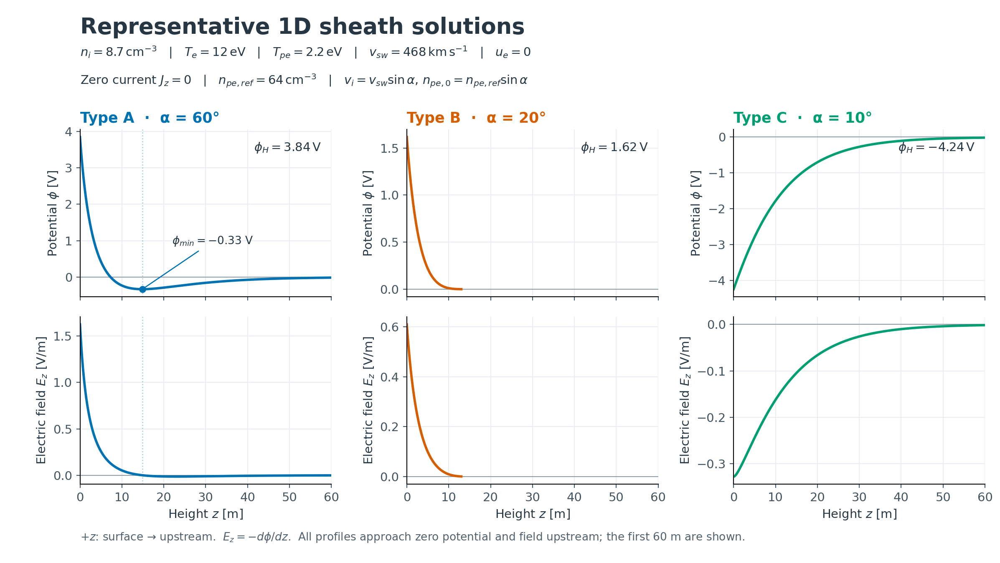
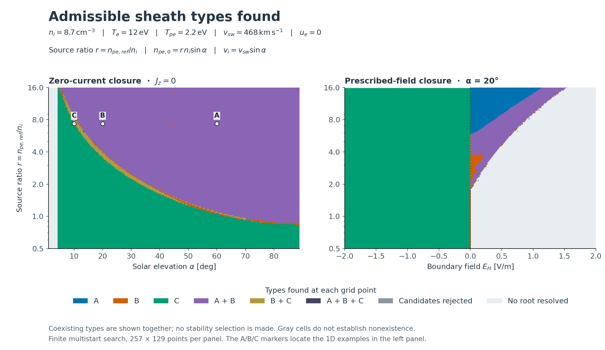

# sheath-model

電子を放出する平面境界の上にできる、一次元・定常・無衝突のシース（Zhao の Type A/B/C 光電子シース）を解く Fortran ライブラリです。
表面電位、電位・電場のプロファイル、粒子流束を求めるほか、粒子シミュレータの計算領域の上端を外部シースへつなぐための条件を返します。
同じモデルの Python 実装も含みます。

- **閉じ方を選べる**: 零電流条件 J=0、境界電場 E_H の指定、電位を与えた静的評価
- **任意の放出スペクトル**: 光電子・二次電子・領域内で反射した電子などを、半 Maxwell 分布か法線エネルギーの bin で与える
- **物理解の判定**: 代数方程式の根のうち、上流につながる半無限プロファイルを持つものだけを返す
- **シミュレータ結合**: matching plane 上の条件、流出スペクトルからの外部源、外部解の更新と checkpoint（BEACH で使用中）

## 計算例

### Type A/B/C のプロファイル

太陽高度を変えたときの電位と電場です。`J=0`・電子ドリフト 0、表面から最初の 60 m を表示しています。

[](docs/figures/sheath_profiles.pdf)

[計算条件・CSV データ](docs/examples.md#profiles)（画像をクリックすると PDF）

### 解の Type マップ

左は `J=0`、右は `E_H` 指定で見つかった解の Type です。いずれも電子ドリフト 0 です。

[](docs/figures/sheath_type_maps.pdf)

複数 Type の表示は安定性による選択を意味しません。灰色領域も含め、解の不存在や全根の発見は保証しません。
[計算条件・凡例・CSV データ](docs/examples.md#maps)（画像をクリックすると PDF）

## 機能

| 機能 | Fortran | Python |
| --- | :---: | :---: |
| J=0（固定入口・太陽高度入力） | ✓ | ✓ |
| E_H 指定、静的評価 | ✓ | |
| bin スペクトルの放出源 | ✓ | |
| プロファイル・局所密度 | ✓ | ✓ |
| 局所の速度分布・流束 | | ✓ |
| 解マップ・continuation | ✓ | ✓（J=0） |
| シミュレータ結合 | ✓ | |

Python は Fortran のバインディングではなく、NumPy/SciPy による独立した実装です。

## 使い始める

fpm プロジェクトの `fpm.toml` に依存を追加し（`rev` は使う commit）、`use sheath_model` で呼びます。

```toml
[dependencies]
sheath-model = { git = "https://github.com/Nkzono99/sheath-model.git", rev = "<commit>" }
```

```fortran
type(sheath_solver) :: solver
type(fixed_entry_equilibrium_input) :: input
type(sheath_equilibrium_result) :: root

input%plasma%emission = maxwellian_emission(55.42562584220407e6_dp, 2.2_dp)
call solver%solve_equilibrium(input, root, status, message)
if (status == SHEATH_OK) print *, root%branch, root%surface_potential_v
```

Python はリポジトリ直下で `python -m pip install -e '.[plot]'` を実行します。
Make・CMake からの利用、最初の計算の全体は [導入と最初の計算](docs/getting-started.md) を参照してください。

## ドキュメント

| 文書 | 内容 |
| --- | --- |
| [導入と最初の計算](docs/getting-started.md) | インストール、依存の追加、最初のプログラム |
| [共通の規約](docs/conventions.md) | 単位、座標と符号、Type A/B/C、ステータスとエラー処理、状態と副作用 |
| [物理モデル](docs/model.md) | 粒子集団、方程式、閉じ方、物理解の判定、適用範囲 |
| [Fortran API](docs/fortran-api.md) | 入力・設定・求解・結果・静的評価・解マップの全項目 |
| [シミュレータとの結合](docs/coupling.md) | matching plane の条件、流出からの外部源、外部解の更新、checkpoint、MPI、利用側の責務 |
| [Python API](docs/python-api.md) | Python の入力・solver・結果・速度分布・解マップ |
| [数値解法と検証](docs/numerics.md) | 規格化、根の探索、continuation、浮動小数点の扱い、テスト |
| [図と計算例](docs/examples.md) | README の図の条件と再生成、実行例の一覧 |

## ライセンス

Python 実装と新規の公開窓口は [MIT](LICENSE)、BEACH 由来の数値実装は [Apache-2.0](LICENSES/Apache-2.0.txt) です。出典は [NOTICE](NOTICE) を参照してください。
