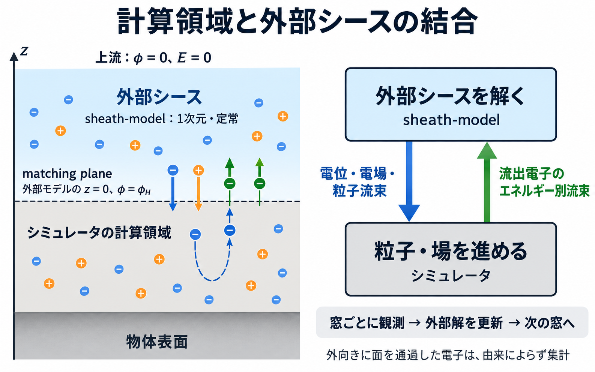

# 粒子シミュレータとの結合

粒子シミュレータの計算領域の上端面を、その上に広がる平面・定常の外部シースへつなぐための Fortran API です。
外部シースが上端面に課す条件の取り出し方、上端面を外へ出た電子から外部シースを解き直す方法、
その状態を checkpoint に保存する方法を説明します。BEACH はこの API を使っており、EMSES など他のシミュレータからも同じ手順で使えます。

ライブラリは粒子種、メッシュ・幾何、面積、粒子重み、MPI、時間積分を扱いません。
条件をどう課すかは利用側が決めます（[利用側の責務](#利用側の責務)）。

## 構成



領域の分担（左）と、観測窓ごとの更新（右）の概念図です。位置・粒子数・矢印は縮尺を持ちません。

- **matching plane**: 結合する上端面です。外部モデルはこの面を自らの境界とみなし、上方を半無限の一次元シースとして解きます。
  面より下の横方向の構造が、外部シースから見て一様な壁として扱える高さに置いてください。
- **電位**: 上流を 0 V とし、面の電位 φ_H は外部根の境界電位です。シミュレータの電位の基準が異なる場合は、利用側で揃えます。
- **放出電子**: 外部モデルにとって、面を外向きに通過する電子はすべて境界からの放出電子です。
  表面からの光電子・二次電子だけでなく、**計算領域内で反射されて面を外へ抜けた上流電子も含めます**。
  面より内側で戻った電子は足し戻しません（[検証記録](../outputs/boundary_validation_20260923/REPORT.md)）。
- **零電流**: J=0 の外部根では、面を通る正味電流が 0 です。面に入る上流電子は外部モデルでは吸収として数え、
  反射して面を出ていく電子は放出源に含めます（そのうち障壁を越える分が escape）。両者を合わせると、面を通る正味電流と整合します。
- **放出電子の種への配分**: `emitted_escape_flux_m2_s` と `emitted_return_flux_m2_s` は、面を外向きに通過した電子全体
  （光電子・二次電子・反射した上流電子の合算）に対する値です。外部モデルは由来を区別しないので、種ごとの脱出・帰還を
  どう割り当てるかは利用側が決めます。放出量が追跡で決まる成分（二次電子、反射した上流電子）には観測した脱出・帰還を
  充て、残りを外部モデルの値へ固定する成分（光電子）に割り当てると、面の電荷収支が窓の中でも閉じます。

結合は弱連成です。シミュレータが一定期間（窓）に観測した流出から外部根を解き直し、その条件を次の窓に使います。
外部解は各窓での定常解であり、時間発展するシースではありません。収束や安定性は保証しません。

## 結合の流れ

1. 上流条件を `plasma_input` に詰め、初回の放出源（例えば表面放出の Maxwell 源）を `plasma%emission` に入れる。
2. `sheath_matching_iteration%initialize` で最初の外部根を解き、`conditions()` で面上の条件を得る。
3. 窓の間、条件に従って上端面で粒子の注入・反射・除去と場の境界条件を課し、面を外向きに通過した電子を法線エネルギーの bin に集計する。
4. 窓の終わりに、集計を MPI で合算して面積と時間で割り、`observed_outflow_source` で放出源にする。
5. `update` で外部根を解き直し、成功すれば新しい条件に切り替える。3 に戻る。
6. checkpoint では `write_state`、再開時は `read_state` を使う。

次は [matching_plane.f90](../example/matching_plane.f90) の抜粋です（`fpm run --example matching_plane` で実行できます）。
流出の集計は人工的な標本で置き換えています。

```fortran
use sheath_model
type(sheath_solver) :: solver
type(plasma_input) :: plasma
type(sheath_matching_iteration) :: outer
type(sheath_matching_conditions) :: plane
type(emission_source) :: source
real(dp), allocatable :: edges(:), weight(:)
integer(i32) :: status
character(len=512) :: message

! 1-2. 上流条件と初回の放出源で外部根を解く
plasma%electron_drift_mps = 0.0_dp
plasma%emission = maxwellian_emission(55.42562584220407e6_dp, 2.2_dp)
call outer%initialize(plasma, solver, status, message)
if (status /= SHEATH_OK) error stop trim(message)
plane = outer%conditions()

! 3. 窓の間: 面を外向きに通過した電子ごとに（K は面での法線運動エネルギー [eV]、w は物理粒子数）
edges = log_energy_edges()
allocate (weight(size(edges) - 1), source=0.0_dp)
weight(energy_bin(edges, K)) = weight(energy_bin(edges, K)) + w

! 4. 窓の終わり: 全ランクで weight を合算してから、面積 [m^2] と窓の長さ [s] で割る
call observed_outflow_source(edges, weight/(area_m2*duration_s), source, status, message)

! 5. 外部根を解き直す。失敗しても前の根と条件が残る
call outer%update(source, status, message)
if (status == SHEATH_OK) plane = outer%conditions()
```

## 面上の条件を取り出す

`sheath_matching_conditions` は、外部根が面に課す条件をまとめた型です。
`sheath_matching_iteration%conditions()` で得るほか、任意の根から直接作れます。

```fortran
call evaluate_matching_conditions(input, root, plane, status, message)
```

`input` と `root` は、J=0 の入力（`fixed_entry_equilibrium_input` または `zhao_equilibrium_input`）と `sheath_equilibrium_result`、
または `prescribed_field_input` と `prescribed_field_result` の組です。探索はせず、根の電位と N_e を解いたときの入力で評価し直します。
無効な根は `SHEATH_INVALID_ARGUMENT`、束が非有限・負になる場合は `SHEATH_NUMERICAL_FAILURE` で、`valid=.false.` です。

| 成分 | 単位・意味 |
| --- | --- |
| `valid`, `branch` | 有効な条件か、根の Type（A/B/C） |
| `plane_potential_v` | 面の電位 φ_H [V] |
| `plane_field_v_m` | 面のすぐ上の電場 E(H⁺) = −dφ/dz [V/m]。A/B は正、C は負 |
| `electron_path_minimum_v` | 面と上流の間で、面の電位とは別に電子が越える電位 [V]。A は極小 φ_m、B/C は 0 |
| `ion_path_maximum_v` | 同じくイオンが越える電位 [V]。常に 0 |
| `electron_reservoir_density_m3`, `electron_temperature_ev`, `electron_drift_mps` | 上流電子の Maxwell 分布の規格化 N_e・温度・内向きドリフト。N_e は上流の全電子密度ではない |
| `ion_reservoir_density_m3`, `ion_entry_speed_mps`, `ion_temperature_ev` | 上流イオンの密度・内向き入口速度・温度 |
| `electron_inward_flux_m2_s`, `ion_inward_flux_m2_s` | 外部モデルで面に入る電子・イオンの数流束 |
| `emitted_outward_flux_m2_s`, `emitted_escape_flux_m2_s`, `emitted_return_flux_m2_s` | 放出源の外向き数流束と、そのうち上流へ抜ける分・面へ戻る分 |
| `net_current_a_m2` | +z 向きの通常電流 `e(Γ_e,in − Γ_i,in − Γ_em,escape)` [A/m²]。J=0 の根ではほぼ 0 |
| `upstream_negative_band_v`, `upstream_field_deficit_v_m` | ドリフトのある A/C の根（J=0・E_H 指定）を受理した上流の帯 [V] と場の不足 [V/m]。それ以外は 0 |

### 粒子の注入・反射・除去

経路の電位は、利用側が持つ面上の局所電位 φ_loc と組み合わせて使います。K は法線運動エネルギー [eV] です。
`min(φ_H, electron_path_minimum_v, 0)` と `max(φ_H, ion_path_maximum_v)` が外部プロファイル全体の電位の最小値・最大値です。

| 判定 | 条件 | 面での法線エネルギー |
| --- | --- | --- |
| 上流の電子が面に届く | K∞ ≥ −min(φ_loc, `electron_path_minimum_v`, 0) | K = K∞ + φ_loc |
| 上流のイオンが面に届く | K∞ ≥ max(φ_loc, `ion_path_maximum_v`) | K = K∞ − φ_loc |
| 面を外へ出た電子が上流へ抜ける | K ≥ φ_loc − min(φ_loc, `electron_path_minimum_v`) | 満たさなければ同じ K で面へ戻る |
| 面を外へ出たイオンが上流へ抜ける | K ≥ max(φ_loc, `ion_path_maximum_v`) − φ_loc | 満たさなければ面へ戻る |

表の判定は次の純関数で得られます。いずれも `sheath_matching_conditions` と面の局所電位 φ_loc [V] を取り、
エネルギーは eV で返します。

| 関数 | 返す値 |
| --- | --- |
| `plane_electron_access_energy_ev(conditions, phi_loc_v)` | 上流電子が面に届く K∞ の下限 −min(φ_loc, `electron_path_minimum_v`, 0) |
| `plane_ion_access_energy_ev(conditions, phi_loc_v)` | 上流イオンが面に届く K∞ の下限 max(φ_loc, `ion_path_maximum_v`, 0) |
| `plane_electron_escape_threshold_ev(conditions, phi_loc_v)` | 面を外へ出た電子が上流へ抜ける K の下限 φ_loc − min(φ_loc, `electron_path_minimum_v`) |
| `plane_ion_escape_threshold_ev(conditions, phi_loc_v)` | 面を外へ出たイオンが上流へ抜ける K の下限 max(φ_loc, `ion_path_maximum_v`) − φ_loc |
| `plane_electron_inward_flux_m2_s(conditions, phi_loc_v, electron_mass_kg)` | 到達条件で制限した上流電子の数流束 [m⁻² s⁻¹]。温度か質量が 0 以下なら NaN |

上流電子の注入には、内向き drift Maxwell 分布 $g(a)\propto e^{-(a-u)^2}$（$a=v_\infty/v_{th}$、$u=v_d/v_{th}$）を、
到達条件を満たす速度に限り、流束で重み付けして標本化します。その数流束
`N_e v_th/(2√π)·[exp(−(b−u)²) + √π u erfc(b−u)]`（b は到達条件の下限速度/v_th）が `plane_electron_inward_flux_m2_s` で、
φ_loc = φ_H なら `electron_inward_flux_m2_s` に一致します。注入量をこの値に合わせると、面の局所電位が φ_H からずれても
外部モデルと整合した流束になります。外部モデルは法線方向だけを定めるので、接線方向の速度分布は利用側で与えます。
温かいイオンは流体モデルで、速度分布を定めません（[イオン](model.md#イオン)）。冷たいイオンでは入口速度のビームです。

外部モデルには外向きに出ていくイオンがありません。面を外向きに通過するイオンが無視できない場合、このモデルの前提から外れます。

### 場の境界条件

面の平均電位を `plane_potential_v` に固定する方法（Dirichlet）と、法線電場を `plane_field_v_m` に合わせる方法（Neumann）があります。
面に表面電荷がなければ E(H⁻) = E(H⁺) です。どちらを使うか、束を目標値として課すか整合の診断に使うかは利用側で選びます。

## 流出スペクトルから放出源を作る

| 手続き | 意味 |
| --- | --- |
| `log_energy_edges([lowest_edge_ev, decades, bins_per_decade])` | 先頭 bin [0, lowest) と対数 bin の境界 [eV]。既定は 1 meV〜1 keV の 24 bin/decade（計 145 bin）。不正な引数では空配列 |
| `log_energy_bin_count([decades, bins_per_decade])` | 同じ引数で `log_energy_edges` が作る bin 数（decades·bins_per_decade + 1）。作れなければ 0 |
| `LOG_ENERGY_DEFAULT_LOWEST_EV`, `LOG_ENERGY_DEFAULT_DECADES`, `LOG_ENERGY_DEFAULT_BINS_PER_DECADE`, `LOG_ENERGY_DEFAULT_BINS` | 既定の下端 1 meV、6 decade、24 bin/decade、bin 数 145。固定長配列を既定 bin 数で宣言するときに使う |
| `energy_bin(edges_ev, energy_ev)` | エネルギーが属する bin の番号。範囲外と NaN は端の bin、bin がなければ 0 |
| `log_energy_bin(energy_ev[, lowest_edge_ev, decades, bins_per_decade])` | `log_energy_edges` と同じ引数の対数格子で、境界配列を作らずに求める bin 番号。`energy_bin(log_energy_edges(...), energy_ev)` と一致する。通過ごとの集計向き |
| `observed_outflow_source(edges_ev, flux_m2_s, source, status, message)` | bin ごとの外向き数流束 [m⁻² s⁻¹] から bin 放出源を作る。空の端 bin は除き、内部の空 bin は残す |

流束は有限・非負で、合計が正でなければなりません。満たさない場合は `SHEATH_INVALID_ARGUMENT` です。
bin 内は dΓ/dK 一定として扱います。平均だけの半 Maxwell 分布へは縮約しないので、
計算領域内の加速や電位の極小で変形したスペクトルの形がそのまま外部根に伝わります。
bin は任意に定義できます。`log_energy_edges` と `energy_bin` は集計の補助です。

## 外部解を更新する

`sheath_matching_iteration` は J=0 の外部根と、それを解いた放出源を保持します。
上流の plasma と solver の設定は利用側の設定であり、状態には含めません。`initialize` と `read_state` で毎回渡します。

| 手続き | 意味 |
| --- | --- |
| `initialize(plasma, solver, status, message [, branch, initial_order])` | `plasma%emission` を放出源として最初の根を解く。`branch` は `'auto'`（既定）/`'A'`/`'B'`/`'C'`、`initial_order` は auto の初回の試行順で `'ABC'` の並べ替え（既定 `'ABC'`） |
| `update(source, status, message)` | 新しい放出源で解き直す。失敗すると放出源・根・条件を前のまま保ち、理由を返す |
| `conditions()` | 受理した根の `sheath_matching_conditions`。初期化前は `valid=.false.` |
| `source()` | 受理した放出源 |
| `accepted_solves()` | 初回を含む受理した求解の回数 |
| `relative_change()` | 最後に受理した更新での、外向き数流束と平均法線エネルギーの相対変化の大きい方 |
| `write_state(unit, status, message)` | 状態を unformatted の unit へ書く |
| `read_state(unit, plasma, solver, status, message)` | `write_state` の状態を、渡した plasma と solver で復元する |

`branch` を指定すると、その Type だけを試します。`'auto'` では、初回は `initial_order` の順に、
更新では現在の Type を先に、残りを A, B, C の順に試し、現在の根を初期値に使います。
Type の継続は数値的な選択であり、安定性による選択ではありません。
例えば低い太陽高度で C から始めたい場合は `initial_order='CAB'` とします。
ドリフトのある A/C を受理する上流の帯の許容値は `solver%search` で設定します（[物理モデル](model.md#ドリフトのある-ac-と上流の帯)）。

`relative_change` は収束の目安で、判定と更新の間隔は利用側で決めます。
`update` の失敗時に前の条件で続けるか、計算を止めるかも利用側で決めます。

J=0 以外の閉じ方（E_H 指定）の反復は提供していません。E_H を利用側から与える場合は、窓ごとに
`solver%solve_prescribed_field` を呼び、その根から `evaluate_matching_conditions` で条件を作れます。

## checkpoint

`write_state` は、版番号、Type の方針、根の Type・電位・N_e、受理回数、相対変化、放出源を書きます。
plasma と solver は書きません。unit は stream・sequential のどちらでもよく、開閉と位置は利用側が管理します。

`read_state` は、保存した放出源と渡した plasma で、保存した Type だけを、保存した根を初期値に解き直します。
見つからない場合や版が異なる場合はエラーで、別の Type へは移りません。
設定を変えて再開すると根が見つからないことがあるので、checkpoint と同じ plasma・solver を渡してください。

## MPI での使い方

ライブラリ自身は通信しません。次の分担を推奨します。

- 各ランクで `weight` を集計し、窓の終わりに全ランクで合算（allreduce）する。
- 全ランクが同じ放出源で `update` を呼ぶ。同じ実行ファイル・入力なら全ランクで同じ根が得られる。
  念のため `status` をランク間で照合すると、不一致を検出できる。
- checkpoint は一つのランクが `write_state` で書き、再開時は全ランクが同じ記録を `read_state` で読む。

## 利用側の責務

| 責務 | 内容 |
| --- | --- |
| 単位系 | シミュレータの規格化単位と SI・eV の換算 |
| 粒子種と集団の対応 | どの粒子種を上流電子・イオン・放出電子とみなすか、上流条件を `plasma_input` に詰める |
| 面の幾何 | 面の位置・法線の向き・面積、電位の基準 |
| 注入・反射・除去 | 上流からの注入（接線方向の速度を含む）、面での反射と除去 |
| 場の境界条件 | φ_H による Dirichlet か E(H⁺) による Neumann か |
| 流出の集計 | 外向き通過の bin 集計、窓の長さ、物理粒子数への換算、MPI 合算 |
| 更新の判断 | 更新の間隔、失敗時の扱い、`relative_change` による収束判定 |
| checkpoint | `write_state`/`read_state` の unit 管理と、再開時の設定の一致 |

新しいシミュレータへ組み込むときは、次を確認してください。

- 面を外向きに通過する電子を、由来によらずすべて集計しているか（計算領域内で反射した上流電子を含む）。
  面で外部障壁に反射して計算領域へ戻す電子も、反射する前の外向き通過として数える。これを除くと、面が極小より下（Type A）の
  状態で、面の上で折り返す遅い光電子が放出源から抜け、外部根が歪む。
- 注入の数流束と `electron_inward_flux_m2_s`・`ion_inward_flux_m2_s`、観測した流出と `emitted_*_flux_m2_s` が整合しているか。
- 面の電位・電場と `plane_potential_v`・`plane_field_v_m` の符号と基準が揃っているか。
- checkpoint から再開した直後の条件が、保存前と一致するか（[matching_plane.f90](../example/matching_plane.f90) の最後を参照）。

## 面がシースの内側にあるとき: 場の連続性を使う閉包

J=0 だけで外部根を選ぶと、面がシースの内側にある場合に、電流は合うが面で場が不連続な状態（例えば遅い上流電子を
入れない Type C）に固定されることがあります。面の上下で場が連続（面に仮想的な電荷がない）ことを条件に加えると避けられます。
EMSES の研究用実装（`feat/outer-sheath-coupling` の `src/physics/sheath/m_outer_sheath.F90`, `closure = "combined"`）は次の手順です。

1. 前回の φ_H の周りで φ_H を走査し、各 φ_H で取りうる状態を `evaluate_sheath_state` で求める。B/C はそのまま、
   Type A は `minimum_potential_v` を動かして `connection_residual_normalized` の符号変化を二分法で詰める。
2. 各状態を ((E(H⁺) − E(H⁻))/σ_E)² + ((J/eΓ_i)/σ_J)² で評価する。E(H⁻) は面の直下の電位から窓平均で求め、
   σ_E・σ_J はその雑音（下限付き）。
3. φ_H を最良の状態へ一部だけ動かし（緩和と 1 窓あたりの上限）、現在の状態の電流が大きい間（計算領域の表面がまだ帯電中）は据え置く。

準 1 次元の柱（4×4 セル）では、面を極小の 2.5 m 下（4.5 m）からシースの外（約 10 λ_D）まで同じ設定で、φ_H は単体解と
0.01〜0.05 V で一致しました。シースの外では E(H⁺) が小さく、精度は E(H⁻) の窓平均の雑音で決まります。

BEACH の実装は、BEACH リポジトリの `src/runtime/sheath/bem_surface_current_model.f90`（条件の写像）と
`src/runtime/sheath/bem_zhao_outflow_refresh.f90`（窓集計・更新・checkpoint）にあります。
