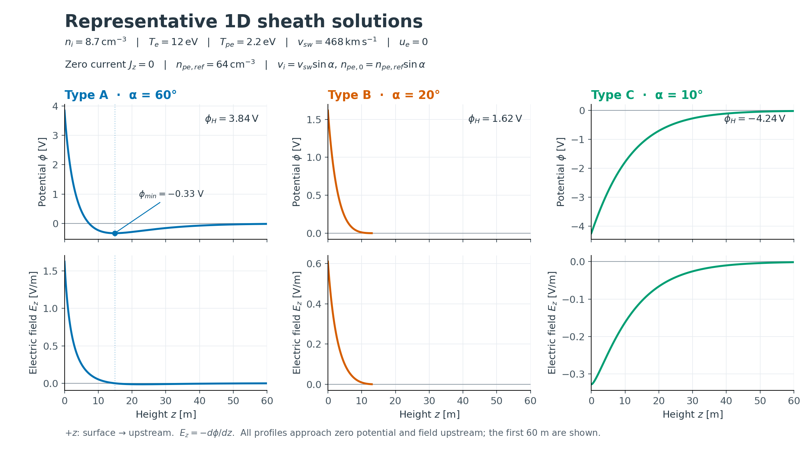
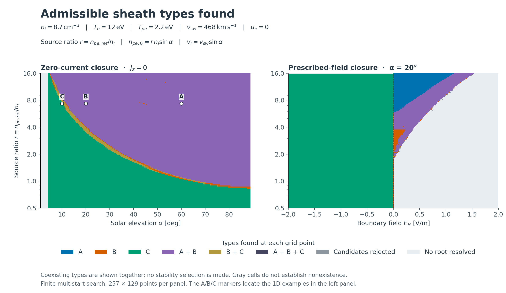

# 図と計算例

このページでは、ドキュメント全体で使う模式図の一覧、Zhao モデルの代表プロファイルと解の Type マップの読み方・再生成手順、および Fortran / Python の全実行例をまとめます。

---

<a id="概念図"></a>
<a id="模式図"></a>

## 1. 模式図の一覧

| 図 | 内容・対応する解説 |
| --- | --- |
| [境界と粒子集団](figures/sheath_overview.png) | Type A の入射・反射・放出・脱出の軌道構成 → [物理モデル：Zhao モデル](model.md#zhao-モデル) |
| [固定入射モデルの電位](figures/fixed_reservoir_schematic.png) | 有限箱、外側領域付きの A と `B_out` で電位の谷が現れる位置の比較 → [有限箱と外側領域](model.md#有限箱と外側領域) |
| [計算領域と外部シースの結合](figures/matching_plane_coupling.png) | matching plane を境にした領域分担と観測窓ごとの弱連成ループ → [シミュレータとの結合](coupling.md#構成) |
| [接合面の候補選択](figures/matching_selection_schematic.png) | 電場・電流残差による目標決定と、緩和・上限付きでの同 Type 候補選択 → [電場と電流を合わせる候補選択](coupling.md#combined-matching) |

粒子集団と領域結合の 2 枚は本文の仕様と照合した概念図です。固定入射モデルと候補選択の 2 枚は、Matplotlib を導入した環境で次を実行すると再生成できます（[examples/plot_schematics.py](../examples/plot_schematics.py)）。

```bash
python examples/plot_schematics.py
```

---

## 2. Zhao モデルの代表計算例

以下のプロファイル図と Type マップは、共通の太陽風・光電子パラメータで計算しています。

### 共通の計算条件

| 量 | 値・定義 |
| --- | --- |
| 上流イオン密度 $n_{i\infty}$ | $8.7\text{ cm}^{-3}$（$8.7 \times 10^6\text{ m}^{-3}$） |
| 背景電子温度 $T_e$ | $12\text{ eV}$ |
| 光電子温度 $T_{\mathrm{pe}}$ | $2.2\text{ eV}$ |
| イオン種・温度 | 陽子、冷たいイオン（$T_i = 0$） |
| 全太陽風速 $v_{\mathrm{sw}}$ | $468\text{ km/s}$ |
| 法線イオン速度 $u_{i\infty}$ | $v_{\mathrm{sw}}\sin\alpha$（$\alpha$ は太陽高度） |
| 背景電子ドリフト $v_d$ | $0$（無ドリフト：`electron_drift_mode = 'zero'`） |
| 光電子源規格化密度 $N_{\mathrm{pe},0}$ | $n_{\mathrm{pe,ref}}\sin\alpha$ |
| 座標・電位基準 | 上流 $0\text{ V}$、$+z$ は境界から上流向き、$E_z = -d\phi/dz$ |

> [!NOTE]
> 背景電子の規格化 $N_e$ は $J_z = 0$ と $E_H$ 指定の両方で未知数として解いています。また電子ドリフトを正にすると厳密な半無限境界で Type A / C が成立しなくなるため（[物理モデル](model.md#ドリフトのある-ac-と上流の帯)）、代表図では無ドリフトにしています。

---

<a id="profiles"></a>

### Type A / B / C のプロファイル

$J_z = 0$、$n_{\mathrm{pe,ref}} = 64\text{ cm}^{-3}$ で太陽高度 $\alpha$ を変え、Type A / B / C をそれぞれ指定して解いた代表プロファイルです。

[](figures/sheath_profiles.pdf)

| Type | 太陽高度 $\alpha$ | 表面電位 $\phi_H$ | 最小電位 $\phi_{\min}$ | 極小高さ $z_m$ | 表面電場 $E_H$ |
| :---: | ---: | ---: | --- | ---: | ---: |
| **A** | $60^\circ$ | $3.840\text{ V}$ | $-0.332\text{ V}$（内部） | $14.87\text{ m}$ | $1.624\text{ V/m}$ |
| **B** | $20^\circ$ | $1.616\text{ V}$ | $0\text{ V}$（上流） | — | $0.609\text{ V/m}$ |
| **C** | $10^\circ$ | $-4.238\text{ V}$ | $-4.238\text{ V}$（表面） | — | $-0.328\text{ V/m}$ |

- Type A は負の表面電位 $\phi_H < 0$ も許しますが、上図は正の表面電位を持つ代表例です。
- 図は $z = 0$〜$60\text{ m}$ を表示しています。計算自体は遠方打ち切り $\lvert \phi \rvert \approx 2.2 \times 10^{-4}\text{ V}$ まで行っており、その先へ人工的な $0\text{ V}$ の線は付け足していません（全範囲は CSV で確認できます）。

| ファイル | 内容 |
| --- | --- |
| [PNG](figures/sheath_profiles.png) / [PDF](figures/sheath_profiles.pdf) | Type A / B / C の電位・電場比較図 |
| [profile_A.csv](figures/data/profile_A.csv) / [profile_B.csv](figures/data/profile_B.csv) / [profile_C.csv](figures/data/profile_C.csv) | 高さごとの電位・電場・電荷密度データ |
| [profile_metadata.csv](figures/data/profile_metadata.csv) | 各代表解の条件・極小点・電流・残差 |

---

<a id="maps"></a>

### 解の Type マップ

[](figures/sheath_type_maps.pdf)

縦軸は光電子源の強さ $r = n_{\mathrm{pe,ref}} / n_{i\infty}$（対数軸）です。左右各パネルとも **$257 \times 129$ 点**（合計 66,306 点）を独立に探索した結果です。

| 項目 | 左パネル：$J_z = 0$（零電流） | 右パネル：$E_H$ 指定 |
| --- | --- | --- |
| 横軸 | 太陽高度 $\alpha = 1^\circ$〜$89^\circ$（間隔 $0.34375^\circ$） | 境界電場 $E_H = -2$〜$+2\text{ V/m}$（間隔 $0.015625\text{ V/m}$） |
| 縦軸 | $r = 0.5$〜$16$（対数等間隔 129 点） | 同左 |
| 太陽高度 | 横軸で走査 | $\alpha = 20^\circ$ に固定 |
| 探索方法 | `solve_equilibrium` で A / B / C を個別指定 | `solve_prescribed_field_candidates` で全候補を取得 |
| 電流 $J_z$ | $0$ を条件として課す | 応答として算出 |

#### 凡例と CSV の読み方

- **色の意味**：この有限探索で見つかった物理解の Type を示します。`A + B` などの複合色は複数 Type の共存を表し、動的安定性による選択は行っていません。左パネルの A / B / C マーカーは前節のプロファイル例の位置です。
- **薄灰色（`No root resolved`）**：採用解がなく、少なくとも 1 つの枝の数値探索が未解決だった点です（なお、試みた候補がすべて物理条件で棄却された点は濃灰色 `Candidates rejected` として描画する設計ですが、本データセットでは該当点が 0 点のため図の凡例には現れていません）。
- **色付きの点でも**：他の枝の探索が未解決のまま残っている場合があります。また、灰色領域を含め、有限個の初期値探索から解の不存在や全根網羅は結論できません。
- **独立探索と近隣解利用**：掲載マップは各格子点を独立に解いているため、低電場の浅い Type A や A / B 境界付近では初期値による検出差が残ります。連続掃引では [example/field_sweep.f90](../example/field_sweep.f90) のように前の解を `initial_guesses` に渡すと、独立探索で漏れる枝を回収できる場合があります。

| ファイル | 内容 |
| --- | --- |
| [equilibrium_map.csv](figures/data/equilibrium_map.csv) | $J_z = 0$ の格子データ |
| [field_map.csv](figures/data/field_map.csv) | $E_H$ 指定の格子データ |
| [summary.json](figures/data/summary.json) | 固定入力・代表解・カテゴリ別格子点数 |

CSV の `types_found`・`unresolved_types`・`rejected_types` はビット値 `A = 1, B = 2, C = 4` の和です（例：`types_found = 3` は `A + B`）。`candidate_count` は報告された候補数です。$E_H$ 側では採用候補がある格子点でも、枝ごとの `sheath_search_diagnostics` に基づく未解決・棄却ビットを保持しています。

---

<a id="図を再生成する"></a>

### 図とデータの再生成手順

リポジトリ直下で実行します（描画には `python -m pip install -e '.[plot]'` が必要です）。

#### 保存済み CSV から図だけを再描画する

```bash
python examples/plot_readme_figures.py
```

`docs/figures/` に PNG / PDF と `summary.json` を書き出します。出力先や入力 CSV の場所を変える場合は `--output build/readme-figures --data ...` を指定してください（[examples/plot_readme_figures.py](../examples/plot_readme_figures.py)）。

#### Fortran でデータから再計算して描画する

公開 API を呼ぶ [example/readme_data.f90](../example/readme_data.f90) を使います。以下は GNU Fortran + OpenMP（16 スレッド）で全 $257 \times 129$ 点を再計算する例です（共有計算ノードでは割り当てコア数と `OMP_NUM_THREADS` を揃えてください）。

```bash
mkdir -p docs/figures/data
OMP_NUM_THREADS=16 OMP_PROC_BIND=false \
  fpm run --example readme_data --compiler gfortran --profile release \
  --flag "-fopenmp" -- docs/figures/data 257 129
python examples/plot_readme_figures.py
```

引数の末尾に `equilibrium` または `field` を付けると、片方のマップだけを再計算できます（引数省略時の既定格子も `257 129` です）。

---

<a id="実行例の一覧"></a>

## 3. 実行例の一覧

すべてリポジトリ直下から実行できます。

### Fortran（`fpm run --example <名前>`）

| 名前 | 内容 | 関連ドキュメント |
| --- | --- | --- |
| [fixed_entry](../example/fixed_entry.f90) | 固定入口・温かいイオンの $J_z = 0$ を解き、静的評価で境界電場を取得 | [導入](getting-started.md) · [$J_z = 0$ 入力](fortran-api.md#j0-の入力) |
| [compare_closures](../example/compare_closures.f90) | 同一条件で $J_z = 0$ と $E_H$ 指定を比較 | [求解メソッド](fortran-api.md#求解メソッド) |
| [equilibrium_profile](../example/equilibrium_profile.f90) | $J_z = 0$ のプロファイル（高さ・電位・電場・電荷密度）を CSV 出力（標準の打ち切り設定を使用） | [プロファイル](fortran-api.md#プロファイル) |
| [field_sweep](../example/field_sweep.f90) | $E_H$ を掃引し、前ステップの候補を初期値に渡して全候補と診断を出力 | [探索の診断](fortran-api.md#探索の診断) |
| [potential_scan](../example/potential_scan.f90) | bin 放出源の Type B を電位走査し、符号付き $E^2$・電場・$N_e$・電流・判定を CSV 出力 | [静的評価](fortran-api.md#静的評価) |
| [solution_atlas](../example/solution_atlas.f90) | $J_z = 0$ 解マップの構築・保存・読込、問い合わせ、候補探索 | [解マップ](fortran-api.md#解マップと-continuation) |
| [field_atlas](../example/field_atlas.f90) | $E_H$ 指定解マップと `arclength` continuation | 同上 |
| [matching_plane](../example/matching_plane.f90) | 面上の条件、流出スペクトルからの放出源、外部解更新と checkpoint 往復 | [シミュレータとの結合](coupling.md) |
| [readme_data](../example/readme_data.f90) | 代表プロファイルと Type マップの CSV データを生成 | [図を再生成する](#図を再生成する) |

### Python（`python examples/<名前>.py`）

| 名前 | 内容 | 関連ドキュメント |
| --- | --- | --- |
| [fixed_entry.py](../examples/fixed_entry.py) | Fortran の `fixed_entry` と同一条件を解き、境界の場と流束を表示 | [導入](getting-started.md#python-で始める) |
| [plot_profiles.py](../examples/plot_profiles.py) | `ZhaoParams` の Type A / B / C プロファイルを `profiles.png` に描画 | [Python API](python-api.md) |
| [solution_atlas.py](../examples/solution_atlas.py) | `EquilibriumAtlas` の構築・保存・読込と候補探索 | [解マップ](python-api.md#解マップ) |
| [plot_readme_figures.py](../examples/plot_readme_figures.py) | 保存済み CSV からプロファイル図と Type マップを描画 | [図を再生成する](#図を再生成する) |
| [plot_schematics.py](../examples/plot_schematics.py) | 固定入射モデルと候補選択の模式図（PNG）を生成 | [模式図の一覧](#模式図) |
