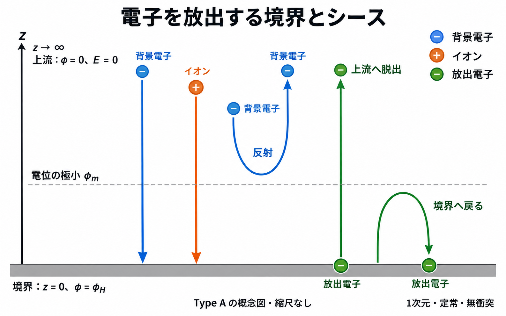
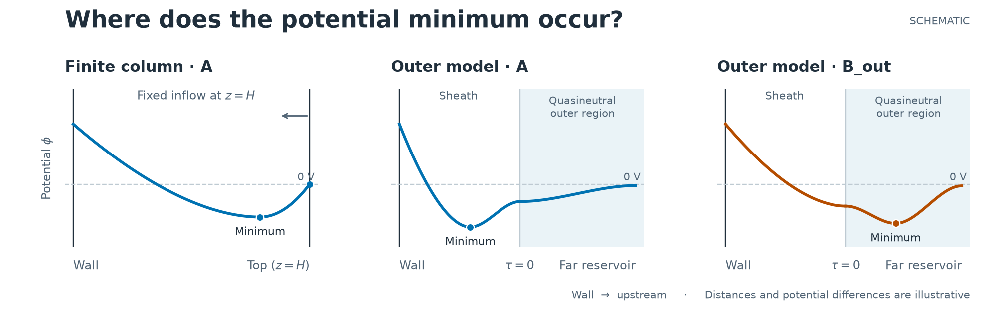

# 物理モデル

このページでは、`sheath-model` が解く物理系、粒子集団の定義、基礎方程式、物理解の判定条件、および適用範囲を説明します。

- 単位・座標・符号・エラー処理の規約 → [共通の規約](conventions.md)
- API の呼び出し方 → [Fortran API](fortran-api.md) / [Python API](python-api.md)
- 数値解法の詳細 → [数値解法と検証](numerics.md)

## 目次

1. [全体像：2 つのモデル族](#対象とする系)
2. [Zhao モデル（半無限・無衝突シース）](#zhao-モデル)
   - [粒子集団（背景電子・イオン・放出電子）](#粒子集団)
   - [電位の形（Type A / B / C）](#電位の形type-abc)
   - [閉じ方と未知数](#閉じ方と未知数)
   - [物理解の判定](#物理解の判定)
   - [ドリフトのある A/C と上流の帯](#ドリフトのある-ac-と上流の帯)
3. [遠方の電子分布を固定するモデル（固定入射モデル）](#fixed-reservoir)
4. [適用範囲と限界](#適用範囲)

---

## 1. 全体像：2 つのモデル族

電子を放出する平面境界（$z = 0$）の上の **一次元・定常シース** を扱います。シース内は無衝突・非磁化とし、粒子は法線方向の全エネルギーを保存します。

上流側の背景電子密度をどう扱うかによって、本ライブラリは次の **2 つのモデル族** を提供します。

| モデル族 | 上流側の扱い | 解く枠組み | 対応言語 |
| --- | --- | --- | --- |
| **Zhao モデル** | 半無限（$z \to \infty$）で $\phi = 0, E = 0$ の準中性域を仮定し、**背景電子の規格化定数 $N_e$ を未知数として解く** | ・零電流（$J_z = 0$） ・境界電場指定（$E_H$ 指定） ・任意電位での静的評価 | Fortran / Python （$E_H$ 指定・静的評価・bin 源は Fortran のみ） |
| **固定入射モデル** （[第 3 節](#fixed-reservoir)） | 遠方 $0\text{ V}$ での**電子分布と全密度をそのまま固定して与える** | ・仮の中性谷底での局所分岐判定 ・上端 $0\text{ V}$・高さ $H$ の**有限箱**（上端電場自由） ・電子置換を伴う準中性**外側領域付き**モデル | Python |

> [!TIP]
> **なぜ 2 つのモデル族があるのか**  
> 半無限・無衝突のシースでは、上流で $\phi = 0, E = 0$ の準中性を保つために背景電子の規格化 $N_e$ に自由度を持たせる必要があります（これが Zhao モデルです）。一方、遠方の電子密度と分布をそのまま固定すると半無限・無衝突のままでは一般に過剰決定になるため、有限箱にするか、シースの外側に電子置換のある準中性領域を接続して閉じます（これが固定入射モデルです）。

---

## 2. Zhao モデル（半無限・無衝突シース）

> 上図は Type A の概念図です。高さ・粒子数・軌道は縮尺を持たず、矢印の横方向のずれは粒子集団を区別するための表現です（モデルが扱う空間変化は $z$ 方向のみ）。定量的なプロファイルは [図と計算例](examples.md#profiles) を参照してください。

### 2.1 粒子集団の概要

Zhao モデルは次の 3 つの粒子集団から構成されます。

| 集団 | 分布の与え方 | 境界（$z = 0$）での扱い |
| --- | --- | --- |
| **背景電子** | 上流で境界向き（$-z$ 向き）にドリフトする Maxwell 分布（温度 $T_e$、規格化 $N_e$、ドリフト $v_d$） | 境界に届いた電子は吸収 |
| **イオン** | 上流で密度 $n_{i\infty}$、内向き速度 $u_{i\infty}$、温度 $T_i$ を持つ超音速流体ビーム | 境界に届いたイオンは吸収 |
| **放出電子** | 境界から上流向き（$+z$ 向き）に出る分布（半 Maxwell 分布または法線エネルギーの bin スペクトル） | 戻ってきた電子は境界で吸収 |

**重要な設計原則**：

- **放出電子の由来は問いません**：光電子・二次電子・粒子シミュレータ内部で反射して面を外向きに抜けた電子をすべて同じ「放出源」として受け取ります。
- **bin スペクトルを近似しません**：bin 源を与えた場合、密度や温度を当てはめて Maxwell 分布へ縮約せず、区分一定の微分数流束そのままを用いて密度・流束・Poisson 積分を計算します。
- **入口条件を自動補正しません**：イオン入口速度を一般化 Bohm 速度へ書き換えたり、収束しないことを理由に電子ドリフトを変更したりしません。

---

### 2.2 背景電子

温度を eV、上流電位を $0\text{ V}$ とし、電子熱速度 $v_{\mathrm{th}} = \sqrt{2eT_e/m_e}$、無次元ドリフト $u = v_d / v_{\mathrm{th}}$、無次元電位 $\psi = \phi / T_e$ を用います。

上流（$\phi = 0$）で境界向きに進む電子の無次元速さ $a = \lvert v_\infty \rvert / v_{\mathrm{th}} \ge 0$ に対する分布を

$$
g(a) = \frac{N_e}{\sqrt{\pi}\,v_{\mathrm{th}}}\,\exp\!\left[-(a - u)^2\right]
$$

と定義します。エネルギー保存より局所の無次元速さ $w = \lvert v_z \rvert / v_{\mathrm{th}}$ は $w^2 = a^2 + \psi$ を満たすため、局所分布は

$$
g_{\mathrm{local}}(v_z) = \frac{N_e}{\sqrt{\pi}\,v_{\mathrm{th}}}\exp\!\left[-\left(\sqrt{w^2 - \psi} - u\right)^2\right] \quad (w^2 \ge \psi)
$$

となります（$w^2 < \psi$ は上流へつながる軌道を持たないため $0$ です。$u \ne 0$ では $e^\psi e^{-(w-u)^2}$ の形に分離できません）。

電子が経路上で越える必要がある最小電位を $\phi_{\min}$ とし $b = \sqrt{-\phi_{\min}/T_e}$ とおくと、

- $a \ge b$ の電子は境界へ到達して吸収されます（自由・通過集団）。境界へ入る数流束は位置によらず
  $$
  \Gamma_{e,\mathrm{in}} = \frac{N_e v_{\mathrm{th}}}{2\sqrt{\pi}}\left[e^{-(b - u)^2} + \sqrt{\pi}\,u\,\mathrm{erfc}(b - u)\right]
  $$
  です。
- $a < b$ の電子は電位障壁で反射して上流へ戻ります（反射集団）。反射集団が存在するのは **Type A の極小より上流側** と **Type C の全域** だけです。
- Type B では $\phi_{\min} = 0$ であり、特に無ドリフト（$u = 0$）のとき $n_e / N_e = \frac{1}{2} e^\psi \mathrm{erfc}(\sqrt{\psi})$ になります。Type A で $\phi_{\min} \to 0^-$ とした極限は Type B と連続につながります。

> [!IMPORTANT]
> **$N_e$ は上流の全電子密度ではありません**  
> 上流（$\phi = 0$）での全電子密度は、入射する背景電子・反射して戻る背景電子・上流まで脱出した放出電子の 3 つの和（$n_{e,\mathrm{total}}(0) = n_{e,\mathrm{free}}(0) + n_{e,\mathrm{reflected}}(0) + n_{\mathrm{em},\mathrm{escape}}(0) = n_{i\infty}$）です。$N_e$ は背景電子 Maxwell 分布の規格化定数であり、入力で固定せず、この上流準中性条件から未知数として決定します。

---

### 2.3 イオン流体

イオンは粒子数流束 $n_i u_i = n_{i\infty} u_{i\infty}$ を保存する 1 次元流体として扱います。上流の法線運動エネルギー $K = m_i u_{i\infty}^2 / (2e)$ [eV]、圧力エネルギー $\alpha = (\text{\texttt{ion\_pressure\_factor}}) \times T_i$ [eV]、密度比 $r = n_i / n_{i\infty}$ とすると、連続の式と圧力項を含む運動方程式の積分は（Sana & Mishra 2026, Eq. 17 に従い圧力係数を一定として）

$$
K\left(\frac{1}{r^2} - 1\right) + \alpha \ln r + \phi = 0
$$

となります。

- **超音速入口条件**：上流で $2K > \alpha$（イオン入口速度がイオン熱音速より速い）を満たす必要があります。解には上流 $r = 1$（$\phi = 0$）から連続につながる超音速側の枝を用います。
- **冷たいイオンの極限（$T_i = 0$）**：$\alpha = 0$ となり、冷たいビームの式 $r = (1 - \phi/K)^{-1/2}$ に一致します。
- **イオンが越えられる最大電位（臨界電位）**：
  $$
  \phi_{\mathrm{crit}} = \begin{cases}
  K - \dfrac{\alpha}{2} - \dfrac{\alpha}{2}\ln\!\left(\dfrac{2K}{\alpha}\right) & (\alpha > 0) \\
  K & (\alpha = 0)
  \end{cases}
  $$
- **VDF に関する注意**：このモデルは密度の流体閉じ方であり、温かいイオン（$T_i > 0$）の速度分布は定義しません。Python の `SheathProfile.vdf` でイオン VDF を取得できるのは冷たいイオンのみです。
- 密度比 $r$ と臨界電位 $\phi_{\mathrm{crit}}$ は、Fortran・Python ともに公開関数 `ion_density_ratio` / `ion_critical_potential` で直接評価できます（[Fortran API](fortran-api.md#補助関数と定数) / [Python API](python-api.md#補助関数とコマンドライン)）。

---

### 2.4 放出電子

境界から $+z$ 向きに出る電子の分布は、法線運動エネルギー $K$ [eV] に対する外向き微分数流束 $g(K) = d\Gamma/dK$ [$\mathrm{m^{-2}\,s^{-1}\,eV^{-1}}$] で定まります。境界から最小電位までの障壁を $B = \phi_H - \phi_{\min} \ge 0$ とすると、

- **$K \ge B$**：障壁を越えて上流へ抜ける（**escape**、自由集団）
- **$K < B$**：途中で折り返して境界へ戻る（**return**、捕捉集団）

| 放出源の種類 | 指定パラメータ | 外向き流束・脱出流束 |
| --- | --- | --- |
| **Maxwell 源** | 半 Maxwell 分布の規格化 $N_{\mathrm{em}}$ [$\mathrm{m^{-3}}$]、温度 $T_{\mathrm{em}}$ [eV] （外向き半分の境界密度は $N_{\mathrm{em}}/2$） | $\Gamma_{\mathrm{out}} = N_{\mathrm{em}}\sqrt{\dfrac{2eT_{\mathrm{em}}}{m_e}} \Big/ (2\sqrt{\pi})$ $\Gamma_{\mathrm{escape}} = \Gamma_{\mathrm{out}}\,e^{-B/T_{\mathrm{em}}}$ |
| **bin 源**（Fortran） | 昇順のエネルギー境界 $[k_0, k_1, \dots, k_N]$ [eV] と各 bin の積分数流束 $\Gamma_j$ [$\mathrm{m^{-2}\,s^{-1}}$] | 各 bin 内で $g_j = \Gamma_j / (k_j - k_{j-1})$ が一定、範囲外は $0$。escape / return は各 bin を $B$ で分割した割合 |

流束は常に $\Gamma_{\mathrm{out}} = \Gamma_{\mathrm{escape}} + \Gamma_{\mathrm{return}}$ を満たします。`return` 流束は境界へ戻る片道 1 回分を数えますが、**局所密度には戻る電子の往路と復路の両方（2 倍）を含めます**。

bin 源の局所密度は、$v_* = \sqrt{2e/m_e}$、$q = \phi_H - \phi$ とすると、各 bin $[k_a, k_b]$ について

$$
n_{\mathrm{free}}(\phi) = \frac{2 g}{v_*}\left[\sqrt{k_b - q} - \sqrt{\max(k_a, B, q) - q}\right] \quad \bigl(k_b > \max(k_a, B, q)\bigr)
$$

であり、戻る電子の密度は区間 $[\max(k_a, q),\ \min(k_b, B)]$ に対して往復分として係数を 2 倍（$4g/v_*$）にします。戻る放出電子が存在するのは **Type A の極小より境界側** と **Type B の全域** だけです。密度・流束・Poisson 積分はすべて同一の $g(K)$ から整合的に計算されます。

---

### 2.5 電位の形（Type A / B / C）

| Type | 電位の形 | 背景電子の反射集団 | 放出電子の戻り集団 |
| :---: | --- | --- | --- |
| **A** | 境界と上流の間に極小 $\phi_m < \min(\phi_H, 0)$ を持つ（$\phi_H < 0$ も可） | 極小より上流側のみ | 極小より境界側のみ |
| **B** | $\phi_H > 0$ から上流の $0\text{ V}$ へ単調減少 | なし | 全域（$B = \phi_H$） |
| **C** | $\phi_H < 0$ から上流の $0\text{ V}$ へ単調増加 | 全域 | なし（$B = 0$） |

- $E_H = 0$ は平坦プロファイル（$\phi \equiv 0$）だけを意味しません。非平坦な Type B / C の根でも $E_H = 0$ を取り得ます。
- 正の規格化密度 $N_e > 0$ を持つ平坦状態は、$E_H$ 指定探索の候補の一つに含まれます。
- Type A の極小が境界へ近づく極限（$\phi_m \to \phi_H < 0$）は、Type C の $E_H = 0$ 端点として表現されます。

---

### 2.6 閉じ方と未知数

Zhao モデルでは、境界条件の与え方（閉じ方）を 3 通り用意しています。いずれも上流（$\phi = 0$）の準中性を課し、$N_e$ を未知数として解きます。

| 閉じ方 | 課す方程式 | 未知数 | 主な出力 |
| --- | --- | --- | --- |
| **$J_z = 0$（零電流）** | 上流準中性、正味電流 $J_z = 0$、Type A は上流接続 | $\phi_H,\ N_e$（A は $\phi_m$ も） | 境界電位、流束、プロファイル（境界電場は静的評価・結合 API で取得） |
| **$E_H$ 指定**（Fortran） | 上流準中性、境界電場 $= E_H$、Type A は上流接続 | 同上 | 境界電位、正味電流 $J_z$、流束 |
| **静的評価**（Fortran） | 上流準中性のみ | $N_e$ のみ（$\phi_H$ と A の $\phi_m$ は入力） | 符号付き境界 $E^2$、A の接続残差、正味電流 $J_z$、流束 |

**Type A の上流接続条件**：Type A では極小 $\phi_m$（$E = 0$）から上流 $\phi = 0$ へ積分した Poisson 一次積分が上流でも $E = 0$ になる必要があります：

$$
-\frac{2}{\varepsilon_0}\int_{\phi_m}^{0} \rho_{\mathrm{upper}}(\phi)\,d\phi = 0
$$

静的評価はこの接続条件を課さずに残差として返すため、時間発展する外側の方程式や利用側独自の閉じ方に組み込んで使えます。

**$E_H$ 指定における固定量と未知量**：

| 呼び出し側が固定する量 | ソルバーが決める量 |
| --- | --- |
| $E_H$、上流イオン密度・速度・温度、背景電子温度・ドリフト、粒子質量、放出源 | $\phi_H$、Type A の $\phi_m$、背景電子の規格化 $N_e$、正味電流 $J_z$ |

> [!NOTE]
> **$N_e$ と $E_H$ を同時に固定する閉じ方は提供していません。** $E_H$ を変えると上流準中性と接続条件を保つために $N_e$ も変化します。半無限条件を保ったまま両方を固定すると一般に過剰決定になるため、遠方の電子密度を固定したい場合は [固定入射モデル](#fixed-reservoir) を参照してください。

#### 太陽風と照射角からの入力変換

`zhao_equilibrium_input`（Fortran）および `ZhaoParams`（Python）は、太陽高度 $\alpha$、全太陽風速 $v_{\mathrm{sw}}$、垂直入射時の光電子規格化密度 $n_{\mathrm{pe,ref}}$ から法線条件を自動構成します。

| 量 | `normal`（既定） | `full` | `zero` |
| --- | --- | --- | --- |
| イオン入口速度 $u_{i\infty}$ | $v_{\mathrm{sw}}\sin\alpha$ | $v_{\mathrm{sw}}$ | —（指定不可） |
| 背景電子ドリフト $v_d$ | $v_{\mathrm{sw}}\sin\alpha$ | $v_{\mathrm{sw}}$ | $0$ |

放出源は温度 $T_{\mathrm{pe}}$、規格化密度 $n_{\mathrm{pe,ref}}\sin\alpha$ の半 Maxwell 源になります。法線イオン速度が $0$ になる入力（`ion_drift_mode = 'normal'` で $\alpha = 0^\circ$）は入力エラーです。

---

### 2.7 物理解の判定条件

代数方程式が収束しただけでは解として採用しません。3 つの閉じ方と静的評価は共通の判定処理を使い、次の **4 条件すべて** を満たす根だけを物理解として返します。

1. **イオンの到達**：経路上の最大電位がイオン臨界電位 $\phi_{\mathrm{crit}}$ 以下であること。
2. **全域で実数の電場（$E^2 \ge 0$）**：電位経路に沿った Poisson 一次積分が非負であること。
   $$
   E^2(\phi) = \begin{cases}
   -\dfrac{2}{\varepsilon_0}\displaystyle\int_{\phi_m}^{\phi} \rho(\phi')\,d\phi' & \text{（Type A：lower / upper 各区間）} \\[1.2em]
   \phantom{-}\dfrac{2}{\varepsilon_0}\displaystyle\int_{\phi}^{0} \rho(\phi')\,d\phi' & \text{（Type B / C）}
   \end{cases}
   $$
   Type A は上流端（$\phi = 0$）で $E^2(0) = 0$（接続条件）も必要です。
3. **Type B の上流漸近条件**：Type B の上流近傍（$\phi \to 0^+$）では $\rho/e = C\sqrt{\phi} + \cdots$ と展開され、$C > 0$ だと上流のごく近傍で $E^2 < 0$ になります。有限点の評価で見逃さないよう、解析係数 $C \le 0$ を検査します。
   - **Maxwell 源**：
     $$
     C = \frac{N_e e^{-u^2}}{\sqrt{\pi T_e}} - \frac{N_{\mathrm{em}} e^{-\phi_H / T_{\mathrm{em}}}}{\sqrt{\pi T_{\mathrm{em}}}}
     $$
   - **bin 源**：後半の放出電子項を $\dfrac{2(2 g_{\mathrm{left}} - g_{\mathrm{right}})}{v_*}$ に置き換えます（$\phi_H$ が bin 端に一致するときは左右の微分数流束を区別します）。
4. **正ドリフトの Type A / C**：次節の条件付き受理を有効にしない限り、$u > 0$ の Type A と Type C は棄却します。

判定は有限個の経路点での数値評価と漸近式に基づいており、任意のパラメータに対する存在定理ではありません。物理条件で棄却された場合は `SHEATH_NO_PHYSICAL_SOLUTION`、数値探索や積分の失敗は `SHEATH_NUMERICAL_FAILURE` になります。

---

### 2.8 ドリフトのある A/C と上流の帯

> [!WARNING]
> **内向きドリフト（$u > 0$）を持つ背景電子と完全反射を仮定した Type A / C は、厳密な半無限の上流条件（$\phi = 0, E = 0$）に接続できません。**

#### なぜ接続できないのか

上流の遅い電子では $g'(0) = 2 N_e u e^{-u^2} / (\sqrt{\pi} v_{\mathrm{th}}) > 0$ となり、反射による鏡像分布 $f(v_z) = g(\lvert v_z \rvert)$ が $v_z = 0$ に尖った極小を持ちます。その結果、上流近傍 $h = -\psi \to 0^+$ で電子密度差に

$$
n_e(-h) - n_e(0) = \frac{N_e\,u\,e^{-u^2}}{\sqrt{\pi}}\,h \ln\frac{1}{h} + O(h)
$$

という対数項が現れ、イオンや放出電子の正則な $O(h)$ 項を上回って、上流に接する狭い電位幅（**上流の帯**）で $E^2 < 0$ となります。

この尖った上流分布は Penrose 判定の積分が対数発散するため、ドリフトの大きさによらず運動論的に不安定であり、現実のプラズマでは緩和や散乱で滑らかになると考えられます。

#### 実務での 2 つの対処法

ライブラリは勝手にドリフトを書き換えません。用途に応じて明示的に選択してください。

1. **無ドリフトで解く**：`zhao_equilibrium_input` / `ZhaoParams` では `electron_drift_mode = 'zero'`、その他では `electron_drift_mps = 0` を指定します。
2. **上流の帯を条件付きで受理する**：$J_z = 0$ および $E_H$ 指定の探索設定（`search`、Python は $J_z = 0$ のみ）で次のいずれか、または両方を正に設定します。

| 設定 | 受理条件 | 意味と目安 |
| --- | --- | --- |
| `upstream_band_tolerance` | 帯の電位幅が、A では $\lvert \phi_m \rvert$、C では $\lvert \phi_H \rvert$ のこの割合以下（$0 \le \text{値} < 1$） | 相対的な電位幅による制限 |
| `upstream_field_floor_v_m` | 帯の内側での場の不足 $\sqrt{-\min E^2}$ がこの値 [$\mathrm{V/m}$] 以下 | 上流境界を $E = 0$ の無限遠ではなく外部電場レベルに置くことに相当。太陽風の運動電場 $\lvert \mathbf{u} \times \mathbf{B} \rvert$（$400\text{ km/s},\ 5\text{ nT}$ で約 $2\text{ mV/m}$）が目安 |

- 両方 $0$（既定）のときは棄却します。両方に正値を指定すると**両方**を満たす根だけを受理します。
- Type A は極小より境界側で $E^2 \ge 0$ を満たす必要があります。
- 受理した根は帯の幅 `upstream_negative_band_v` [V] と場の不足 `upstream_field_deficit_v_m` [$\mathrm{V/m}$] を返し、プロファイルは帯の手前で打ち切ります。根の方程式（準中性・零電流・A の接続）は変わらないため、境界側の電位や流束は判定の仕方によりません。

> **独立検証の結果**：たとえば $n = 5\text{ cm}^{-3},\ T_e = 10\text{ eV}$、$400\text{ km/s}$ 法線入射、$4.5\ \mu\mathrm{A/m}^2\cdot 2.2\text{ eV}$ 光電子の条件では、帯の幅は A で約 $51\text{ mV}$（$\lvert \phi_m \rvert = 0.79\text{ V}$ の $6.5\%$）、光電子なしの C で約 $3\text{ mV}$ でした。遅い入射電子（$a \lesssim a_s$）のドリフトだけを除いて $g'(0) = 0$ とし軌道整合のまま解き直すと、A は $a_s \ge 0.07$、C は $a_s \ge 0.02$ で帯が消え、境界側の量は帯を受理した根と数十 mV 以内で一致しました（[検証記録](../outputs/upstream_relaxation_20261009/REPORT.md)）。

---

## 3. 遠方の電子分布を固定するモデル（固定入射モデル）

Python パッケージでは、Zhao モデルのように $N_e$ を調整するのではなく、**$0\text{ V}$ の遠方リザーバーにおける全速度域の電子分布と密度をそのまま固定して与えるモデル** を提供しています（API の詳細は [Python API](python-api.md#fixed-reservoir)）。

- **背景電子**：法線方向のドリフト Maxwell 分布の和（`MaxwellianElectrons`）、または中心静止の $\kappa$ 分布（`KappaElectrons`、有限流束のため $\kappa > 1$）。
- **イオン**：Zhao モデルと同じ超音速流体。
- **放出電子**：局所判定では半 Maxwell・bin・任意の `EmissionSpectrum` を利用可能。有限箱と外側領域付きプロファイルでは壁で零電流を課し、正の半 Maxwell 源（`MaxwellianEmission`）を用います。

### 3.1 仮の中性谷底での局所的な分岐判定

遠方 $0\text{ V}$ から測った仮の電位の谷の深さを $d > 0$ [V] とします（谷底電位は $-d$）。`classify_branch` は次の手順で分岐側を診断します。

1. **零電流から脱出流束を決める**：深さ $d$ の谷を越えて壁へ届く入射電子流束 $\Gamma_{e,\mathrm{in}}(d)$ からイオン流束 $\Gamma_i$ を引き、零電流に必要な放出電子の脱出流束 $\Gamma_{\mathrm{esc}}(d) = \Gamma_{e,\mathrm{in}}(d) - \Gamma_i$ を求めます。
2. **放出障壁と中性谷底を探す**：$\Gamma_{\mathrm{esc}}(d)$ を与える壁〜谷間の障壁 $B(d)$ を放出スペクトルから逆算し、谷底で「通過する背景電子密度＋通過する放出電子密度 $=$ イオン密度 $n_i(-d)$」となる深さ $d$ を探します。
3. **谷底の位相空間密度比 $R$ を評価する**：仮の中性谷底で法線速度 $0$ に到達する放出電子と背景電子の位相空間密度の比
   $$
   R = \frac{g_{\mathrm{em}}(v_z = 0)}{g_{\mathrm{bg}}(v_z = 0)}
   $$
   を計算します。境目近くで連続につながる解では、
   - **$R > 1$**：谷が壁と準中性域の間（無衝突シース内）に現れる **Type A** 側
   - **$R < 1$**：壁〜準中性域が単調になり、谷は外側へ出る **Type B** 側

さらに有限の電位オフセット $\Delta\phi > 0$ に対して、谷底より $\Delta\phi$ だけ高い両側の点で折り返す電子分布から $E_{\mathrm{wall}}^2 - E_{\mathrm{up}}^2$ を直接積分評価する関数 `turning_field_difference` も提供しています。

### 3.2 有限箱と外側領域付きモデル

> 縦軸は電位、横方向は壁から上流への位置です。青い背景が準中性の外側領域（接合点 $\tau = 0$）を表します。距離と電位差は模式的です。

#### 有限箱（`solve_finite_column`）

有限の高さ $H$ に $0\text{ V}$ の上端を置き、上端からの入射分布を固定し、**上端電場を自由** にして壁での零電流解を求めます。Poisson 一次積分から求まる長さが $H$ に一致するように、単調解（`B` / `C`）では上端電場、谷を持つ解（`A`）では谷の深さが決まります。単調解で届く最大高さを超える箱では、箱の内部（上端付近を含む）に谷を持つ `A` 解が現れます。

#### 外側領域付きモデル（`solve_presheath`）

遠方リザーバーを $0\text{ V}$・電荷中性（全電子密度 $=$ イオン密度）とし、系を **薄い無衝突シース** と **準中性の外側領域** に分けます。

- 外側領域の座標は、準中性域の接合点から測った光学距離 $\tau = \int dz / \ell(z)$ です（$\ell(z)$ はシース厚さに比べ十分長い電子置換長）。
- 軌道に沿った光学距離差 $\Delta\tau$ に対し、電子分布と置換先分布の差は $\exp(-\Delta\tau)$ で緩和します。
- 外側で反射して壁側へ戻る電子は往復の両方で置換されます。置換先には遠方の同方向の電子分布をエネルギー保存で運んだもの（遠方に存在しない負の法線エネルギーには遠方の速度 $0$ の値）を使います。外側の谷（深さ $d$）の手前で反射する軌道（エネルギー $0 \le \varepsilon \le d$）では、置換先に残る内外分布差に一次混合因子 $\varepsilon / d$ を掛けます。

| 枝（`branch`） | 電位プロファイルの形 |
| :---: | --- |
| **`A`** | 谷が無衝突シース内にある。外側領域は準中性接合点から遠方 $0\text{ V}$ へ向かって単調に上がる |
| **`B_out`** | 谷が準中性の外側領域内にある。中性曲線の折り返し点で無衝突シースへ接続する |
| **`B_nw`** | 谷がなく、正電位の準中性接合点から遠方 $0\text{ V}$ へ単調に下がる |
| **`C`** | 放出が弱く壁が最低電位（負）となる。放出電子はすべて上流へ脱出する |

---

## 4. 適用範囲と限界

- **幾何・定常性**：平面・一次元・定常のみを扱います。シース内は無衝突・非磁化で、外側領域付きモデルでのみ電子置換を導入します。
- **イオンの扱い**：上流から連続する超音速流体であり、逆流するイオンや亜音速の入口は対象外です。
- **境界**：放出源を除き完全吸収です。
- **安定性・一意性**：動的安定性や時間履歴による枝の選択は扱いません。複数解が存在する場合は候補として返します。
- **探索の有限性**：解の存在・非存在や全根の発見は、有限個の初期値・探索範囲・数値積分許容値の範囲での結果に限られます。
